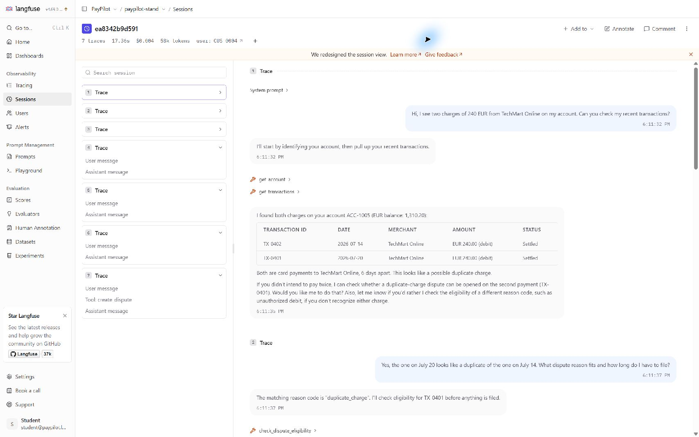

# PayPilot — Observability & Cost Report / ДЗ_7

Статус: вимірювання завершені; роботу підготовлено до здачі з публічного [репозиторію ДЗ_7](https://github.com/Dmitriy004/paypilot-hw07-observability), гілка `main`. Фінальний v2 clean — **7 з7 PASS**, lesson-08 — **5 з7 PASS**, FAIL рівно CONV-H04-BUDGET і COST-H06-EMPTY, як в окремому прогнозі до прогонів. V1 clean false-positive H03 і всі проміжні/негативні результати збережені.

| Поле | Значення |
|---|---|
| Система / версія | PayPilot shared stand `74f1995ca8e8e64e4526e374535c2c4e71a2bde1` |
| Дата / seed clock | 2026-11-04 / `2026-09-15T10:00:00Z` |
| Модель агента у прогонах | `anthropic/claude-haiku-5.5`, OpenRouter, reasoning off |
| Поточний тариф | input $0.10/M, output $0.50/M, cache-read $0.01/M, cache-write $0.125/M; prompt ≥100k має окремий дорожчий tier |
| Модель порівняння | `google/gemini-2.5-flash`: input $0.30/M, output $2.50/M, cache-read $0.03/M, cache-write $0.0833333333/M |
| Джерело тарифу | [OpenRouter API /models](https://openrouter.ai/api/v1/models), перевірено 2026-11-04; [snapshot](tariffs.json) |
| Backend / інструменти | локальний Langfuse 4.69.0 + Phoenix; L03 `7d0f5e7`, L08 `666e496`; [manifest](source-manifest.json) |
| Офіційні прогони | B4: 2 моделі ×2 сценарії ×2 умови ×5 =40 діалогів; B3: 2 умови ×5 =10 діалогів |
| Власний набір | п'ять незмінених власних L05 turn lists як budget views, новий empty-result budget і легітимний account control; разом 7 кейсів, із них 6 бюджетних |
| Фінальна перевірка | SHA256 `e9cf3e571e175b9c0d6c37a462032a229c7179ce3bfa35c00dbd66683e658d26`; 27 діалогів /182 кроки на профіль, чистий клон `c1d056d`; [протокол перевірки](holdout.json) |

## Слайд 1. Лічильник не є трейсом, а трейс не є рахунком

### Семишагова сесія та перевірка Langfuse

C-07 / B2 clean Haiku, session `ea8342b9d591`: **7 запитів agent.request**, 12 generation-спанів, 25 observations.
Langfuse Total Cost за API = **$0.003878159998**; сума округленого `usage.provider_cost_usd` семи відповідей = **$0.003877**. Різниця $0.000001159998 сумісна з округленням кожної відповіді до шести знаків.
Доказ: [langfuse-session.json](langfuse-session.json), запити `63a9197eb2a64c9d` … `cfe1d5d759524f7d`.

У Langfuse4.69 семишаговий список знаходиться зліва, а Total Cost у шапці округлено до **$0.004** (accessibility description: exact **$0.003878**). Особисті вкладки/закладки не потрапили до скріншота. UI duration17.36s не використовую як суму server latency: для цієї сесії raw root durations сумарно **19.0517s**, а інтервал від першого root start до останнього root end **19.2134s**. У порівняльних таблицях нижче послідовно застосовано саме суму root duration, не змішані визначення часу.

Langfuse API v4 працює через `/api/public/v2/observations`; старий `/api/public/traces` повертає events_only error. Це обмеження API, а не відсутність експорту: 25 observations цієї сесії доступні через v2.
Для точного імені `anthropic/claude-haiku-5.5` додано локальне model definition з regex `(?i)^anthropic/claude-haiku-5[.]5$` та всіма exclusive usage buckets. Сам `stand.cost_usd` у metadata не означає автоматичне заповнення Langfuse Total Cost.

### Перший спан втрати сутності: не остання відповідь

Контрольований B3: ті самі чотири репліки, Haiku, reasoning off, `summarize_after=2`; міняється профіль clean → lesson-05 (`D06,D07`). [Офіційний звіт](b3.json).

| Крок / спан | Первинний доказ | Що втрачено / наслідок |
|---|---|---|
| 1–2, до згортки | У `summary.input` записані tool transactions: `"id": "TX-0401"`, `"amount": 240.0`; eligibility має `"reason_code": "duplicate_charge"` | Сутності ще присутні у вхідній історії, отже це не початковий retrieval miss |
| **3, agent.summarize** | request `bd77f457a3e04136`, span **`033558ed9a7a4ba0`**: вхід містить `TX-0401` і `duplicate_charge`; вихід нижче не містить жодного з них | **Перша доведена втрата номера й reason code; reason підмінено на service_not_rendered** |
| 3, наступний llm/tool chain | Той самий request: після summary йдуть llm.call → get_account → get_transactions → llm.call → search_knowledge_base → llm.call | Агент повторно збирає контекст; зайві виклики й довша історія узгоджуються зі зростанням вартості, але не доводять єдину причину всіх downstream змін |

Дослівний `summary.text` із цього спану:

> **Summary:** Customer Danylo Kovalenko reports two identical charges from TechMart Online on his EUR account and asks whether the later one can be disputed as a duplicate. I confirmed both charges, verified the dispute is eligible under the service_not_rendered reason code, and asked the customer to confirm before filing a dispute for the later charge. The filing deadline is close, so the case is time-sensitive.

Первинний файл: [B3 defect run2, step3](evidence/20261104T171614.119451Z/000027.json).
На clean summary зберіг обидві сутності **5 з 5**; на lesson-05 обидві збереглися **0 з 5**. У двох дефектних прогонах губився лише reason, тому твердження «обидві сутності зникли у всіх п'яти» було б неправильним.

**Речення для регулятора:** у запиті `bd77f457a3e04136` спан `agent.summarize/033558ed9a7a4ba0` отримав історію з TX-0401 і duplicate_charge, але видав згортку без цих ідентифікаторів та з service_not_rendered, тобто спотворення виникло при згортанні вже наявного контексту, до наступного виклику моделі.

### Три незалежні джерела ціни

Медіани USD/цілий діалог, **n=5 у кожному рядку**, одна модель Haiku. B1 defect — clean+D14; B2 defect — lesson-08. B1/B2 взято з Haiku cells B4, не видано за додаткові незалежні прогони.

| Сценарій / умова | /chat usage.cost_usd | llm.call за реальним тарифом | Усі generation-спани, включно summary | provider_cost_usd |
|---|---:|---:|---:|---:|
| B1 clean | 0.000333 | 0.00033332 | 0.00033332 | 0.000333 |
| B1 clean+D14 | 0.000417 | 0.00142303 | 0.00142303 | 0.001423 |
| B2 clean | 0.003227 | 0.00322743 | 0.00322743 | 0.003228 |
| B2 lesson-08 | 0.004267 | 0.00426626 | 0.00426626 | 0.004267 |
| B3 clean, summary after2 | 0.001358 | 0.00135691 | 0.00182721 | 0.001827 |
| B3 lesson-05, summary after2 | 0.002024 | 0.00202443 | 0.00229003 | 0.002290 |

Кожна клітинка — медіана власної послідовності сум; різниця медіан не обов'язково є медіаною різниць. [Перерахунок із raw](summary.json), [код](aggregate.py), [B4](b4.json), [B3](b3.json).

| Порівняння defect / clean, Haiku | Median input tokens | Median time, ms | Median provider USD | Tokens ratio | Time ratio | Cost ratio |
|---|---|---|---|---|---|---|
| B1, n=5+5 | 11129 →33508 | 4215.3 →15077.8 | .000333 →.001423 | 3.011× | 3.577× | 4.273× |
| B2, n=5+5 | 50564 →60262 | 19051.7 →18122.8 | .003228 →.004267 | 1.192× | .951× | 1.322× |
| B3, n=5+5 | 23216 →32576 | 15099.5 →16613.4 | .001827 →.002290 | 1.403× | 1.100× | 1.253× |

Час тут — сума server root duration_ms, не оцінка й не час завантаження Docker. У B2 вартість зросла, а медіана часу впала: **не роблю висновку, що D15 прискорює систему**, вибірка мала, маршрутизація/кеш/кількість генерацій варіюють. Для L03 latency окремо вимірюється wall clock цілого діалогу без HTTP-збору трейсів.

Сліпі зони:

- `usage.cost_usd` при D14 не бачить усі повтори: медіана B1 $0.000417 проти фактичних $0.001423. У Gemini найгірший виміряний B1 мав 88 однакових tool calls і ціну $0.056162; цей outlier не викинуто.
- Langfuse без відповідного model definition не може сам вивести коректну ціну лише з імені; metadata `stand.cost_usd` і розрахований Total Cost — різні поля. Перевірено обидві сторінки187+ моделей: жоден вбудований Haiku pattern не збігається з точним OpenRouter ім'ям `anthropic/claude-haiku-5.5`; збігається наше project definition. Не видаю це за вимір live NULL до налаштування — це перевірка конфігурації та її пояснення.
- Input/output-only definition пропускає `input_cached_tokens`, `input_cache_creation_tokens`, `output_reasoning_tokens`. Конкретний приклад: generation span `6e7538b5a9cddf3c`, trace `23be2e731024403be82097782f99ba83` у збереженій Langfuse-сесії:3695 fresh input +2513 cached +208 output; повна ціна **$0.00049863**, input/output-only **$0.00047350**, недораховано **$0.00002513** cache-read. У цьому наборі reasoning off; не стверджую, що виміряв економію reasoning. Суми reasoning вже входять до output, повторно їх не додаю.
- `agent.summarize` — оплачуваний generation. Kit $trace рахує тільки llm.call; root usage також не є повним рахунком. B3 median summary tokens: clean1811, defect1587; повний provider ratio1.253×, а llm.call-only ratio1.492×.
- Gemini cache-write overlap і поточний тариф враховано окремо; 1481 cache-write token реально зустрівся у B4. Старе значення factor .3778 у kit/stand не можна вважати актуальним прайсом. Найдовший prompt офіційних вимірів був 8017 tokens: дорогий Haiku tier перевірений тестом, але не навантажувальним експериментом ≥100k.

## Слайд 2. Чотири поверхи вартості й масштаб 800 користувачів

| Рівень | Вимір / розрахунок | Межа застосовності |
|---|---|---|
| Крок | B1 clean Haiku run1 step1, request `ee0e152168794c3e`: **$0.000427** provider, **$0.000427355** тариф, **2 llm.call**, **2202.4ms** root | Одне повідомлення не дорівнює одному LLM call; D14 повтори теж оплачуються за всіма спанами |
| Діалог | Haiku clean B1 median $0.000333, B2 $0.003228; по5 повторів | Це 2- і 7-крокові сценарії, не взаємозамінні одиниці |
| Місяць | 800×20×(.8×.000333+.2×.003228) = **$14.592** на Haiku; Gemini: **$26.112** | Лише модельний inference, не hosting/Langfuse/storage/judge; не production billing forecast |
| N користувачів | `C(N)=N×20×(.8×median_B1+.2×median_B2)`; Haiku `0.01824×N` USD | Лінійно за N лише при фіксованих довжині/міксі/кеші/дефектах |

**Джерело припущень — авторський planning scenario для цієї роботи, не продуктова аналітика:** 800 активних користувачів/місяць, 20 діалогів на користувача, 80% коротких довідкових B1 і20% довгих dispute B2. Числа позначені припущеннями; їх треба замінити telemetry продукту, коли вона з'явиться.

Для стрес-сценарію, якщо весь той самий мікс працює у дефектних умовах, Haiku коштував би `16000×(.8×.001423+.2×.004267)=$31.8688`, а не $14.592. Це **не оцінка ймовірності дефекту**, а what-if.
За фіксованої кількості діалогів N саме по собі не створює нелінійності. Якщо зростає число ходів T, повторне перечитування історії дає суму `1+…+T=O(T²)` input; replay та неконтрольовані retry множать це навантаження. Більші N можуть також погіршувати черги/latency, але concurrent capacity тут не виміряна.

## Слайд 3. Рішення: економимо без підміни якості лічильником

### Міграція моделі: дві моделі, два сценарії, п'ять повторів кожної умови

USD — kit tariff sum, що збігається з округленим provider median; time — сума root ms з B4. Всі рядки **n=5**; діапазони — min–max діалогу, не довірчий інтервал.

| Модель / сценарій / умова | Median USD [min–max] | Median s [min–max] | Вердикт |
|---|---|---|---|
| Gemini B1 clean | .000518 [.000498–.000592] | 3.312 [3.054–5.408] | 5 з5 PASS |
| Gemini B1 D14 | .007006 [.001918–.056162] | 21.181 [8.989–77.380] | 0 з5 PASS |
| Gemini B2 clean | .006088 [.005118–.006614] | 11.383 [10.596–12.180] | median3131≤6500; 5 з5 нижче межі |
| Gemini B2 lesson-08 | .007947 [.007780–.009212] | 12.492 [11.404–13.147] | median3760≤6500; 5 з5 нижче межі — дефект пропущено |
| Haiku B1 clean | .000333 [.000319–.000609] | 4.215 [4.082–4.624] | 5 з5 PASS |
| Haiku B1 D14 | .001423 [.001402–.001444] | 15.078 [14.474–15.930] | 0 з5 PASS |
| Haiku B2 clean | .003228 [.003145–.003877] | 19.052 [18.246–19.632] | median5387≤6500; 5 з5 нижче межі |
| Haiku B2 lesson-08 | .004267 [.004251–.005342] | 18.122 [17.868–18.898] | median6686>6500 FAIL; лише1 з5 нижче межі |

У stock B4 поле `passed=5` для B2 не означає, що п'ять індивідуальних token-порогів пройдено: цей сценарій має **aggregate assertion**. Вище наведені фактичні per-run step6 значення та окремо його median verdict, а не вакуумний passed counter.

**Рішення: умовно обираю Haiku для цього набору, не оголошую повну якісну міграцію завершеною.**

1. Clean діалог дешевший на Haiku: B1 в1.556×, B2 в1.886×; але B2 повільніший у1.674×. Порівнюю USD/діалог і час, не token counts різних tokenizer.
2. B1 clean лишився зеленим5 з5, D14 виявляється0 з5 PASS на обох моделях; B2 clean зелений, а дефект відділився лише на Haiku. Зелений Gemini defect — false negative порога, не доказ відсутності replay.
3. Ці перевірки не бачать коректність reason/deadline/підсумкового тексту, достатність документів, тон, доречність та правомірність фінального write. B3 — конкретний механічний контроль сутностей, не універсальний quality judge.

| Важіль | Вимір / очікувана користь | Trade-off і легітимний сценарій, який може постраждати |
|---|---|---|
| Прибрати replay / нормальна історія | B2 Haiku .004267→.003228 USD, близько24.3% менше на цьому сценарії | Надмірне скорочення історії може стерти TX/reason: B3 це реально показав. Не замінювати replay втратою фактів |
| Обмежити ідентичні retry порожнього tool result | B1 clean .000333 проти D14 .001423 USD; усунути зайві повтори | Наївна дедуплікація зламає легітимний повтор після тимчасової помилки або зміни даних. Потрібні freshness/error-aware правила, а не заборона будь-якого повтору |
| Дешевша модель Haiku | Місячний planning mix $14.592 проти $26.112 Gemini | Виміряна latency B2 19.052s проти11.383s; потрібні нові model-specific пороги та L09 quality evaluation |

| Рядок рішення | Значення |
|---|---|
| Що обміняли | Нижча USD/діалог ціна на вищий час Haiku; агрегатний token budget на обмежену впевненість у поведінці |
| Чого не робимо | Не прирівнюємо PASS бюджету до правильного спору; не переносимо 6500 між моделями; не впроваджуємо незворотні write без незалежної engine-перевірки |
| За яких умов рішення зміниться | Порушений latency SLO, новий тариф/модель/turn mix, падіння legitimate controls або L09 quality judge — повторна калибровка і перегляд маршрутизації |

### Бюджети в кейсах і незалежний контроль

Exploratory clean завершений: [звіт](../reports/l05_dialogs-clean-20261104T172714.json), set_hash `7b3d2a38ceac`, **7 з7 PASS** із широкими нефінальними token budgets. Це не підтвердження фінального порога. Далі застосовується [заздалегідь закомічений протокол](calibration-protocol.md), після нього — окремий final-set forecast commit і нові прогони з чистого клону.

Початковий H01 +20% пропустив D15: clean median39597, defect43225, threshold47517. Не приховую цей негативний результат. До фінального прогнозу вибрано стабільніший H04 і наперед записано [протокол v2](calibration-protocol-v2.md) з запасом5%; він потім отримав окремі exploratory5 defect runs. [Повні дані калібрування](calibration.json).

| Калібрування H04, по5 на умову | Поріг | Clean median44787 [44337–45645] | lesson-08 median53464 [53232–54083] | Висновок |
|---|---:|---|---|---|
| Надто вільний | 59492 | PASS,5 з5 значень нижче | PASS,5 з5 нижче | Пропускає replay |
| Надто тісний | 43891 | FAIL,0 з5 нижче | FAIL,0 з5 нижче | Нормальний clean workload уже не вкладається; це false positive, а не знайдений дефект |
| Обраний: clean median×1.05, ceil | **47027** | **PASS,5 з5 нижче** | **FAIL,0 з5 нижче** | Чутливий на exploratory; ще потрібен незалежний holdout |

| Фінальний ID | Поріг / контроль | Gate / runs | Підстава |
|---|---|---|---|
| CONV-H01-BUDGET | tokens_total47517 | release/5 | clean median39597 +20%; відомий пропуск помірного D15 |
| CONV-H02-BUDGET | tokens_total63449 | release/5 | median52874 +20% |
| CONV-H03-BUDGET | **v2 tokens_total33306** | release/5 | combined10-clean median19032 +75%; допустима KB strategy має вищу ціну |
| CONV-H04-BUDGET | tokens_total47027 | release/5 | median44787 +5%, окреме калібрування |
| CONV-H05-BUDGET | tokens_total41135 | release/5 | median34279 +20% |
| COST-H06-EMPTY | identical_tool_calls_max1 | daily/1 | Порожній результат не є приводом повторювати той самий tool call |
| COST-CTRL-ACCOUNT | get_account | daily/1 | Легітимний функціональний контроль, не budget case |

V1 set_hash `4c125924888f`, [прогноз0d340b6](prediction-final.md): lesson-08 отримав очікувані **5 з7 PASS**, упали рівно H04/H06; clean отримав **6 з7**, неочікувано впав H03. [Clean v1](../reports/l05_dialogs-clean-20261104T182329.json), [lesson-08 v1](../reports/l05_dialogs-lesson-08-20261104T181529.json). Це **помилка clean прогнозу**, не «7/7».

Причина H03 доведена трейсами: clean replay=false, active_defects порожній. У run1 лише eligibility,6 llm.call і18877 tokens; у run3 два knowledge lookups+eligibility,7 llm.call і30052 tokens. Медіана clean-v1 [18877,18755,30052,23151,26191] =23151>22834. Поріг недооцінив **нормальну retrieval variance**, а не знайшов D15. Докази: [run1 step1](evidence/20261104T181609.677227Z/000086.json), [run3 step1](evidence/20261104T181609.677227Z/000096.json), [аналіз і нова калібровка](calibration-v2.md).

У v2 змінено **лише H03 budget**: спільна медіана10 clean samples19032 +75%=33306, що на10.8% вище спостереженого clean max30052. Це широкий guard грубої ціни; він пропускає помірний D15 — чутливий H04 з47027 не послаблено. Регресійний тест реального clean-v1 прикладу пройшов RED→GREEN, а H04 replay досі FAIL за graderом. V1 незмінний у commit d0f8b34 і звітах; його дані тепер exploratory для v2.

Фінальний v2 set_hash **`e9cf3e571e17`**, [окремий прогнозc1d056d](prediction-v2.md) з точними FAIL IDs H04/H06. Коміт створено о18:27:14 UTC, перший новий /chat у raw — о18:27:36 UTC. Нові повні holdout прогони виконано на чистому клоні цього коміту, без подальшої зміни набору; між умовами змінено **лише profile**. [Clean v2](../reports/l05_dialogs-clean-20261104T184110.json): exit0, **7 з7**; [lesson-08 v2](../reports/l05_dialogs-lesson-08-20261104T183406.json): exit1, **5 з7**, без ERROR. Прогноз усіх7 case verdicts справдився в обох умовах. [Manifest перевірки](holdout.json).

| Фінальний кейс v2 | Clean: median / рахунок під порогом | lesson-08: median / рахунок під порогом | Case verdict clean / defect |
|---|---|---|---|
| CONV-H01-BUDGET, tokens≤47517 | 39984;5 з5 | 43400;4 з5 | PASS / PASS |
| CONV-H02-BUDGET, tokens≤63449 | 51421;5 з5 | 54821;4 з5 | PASS / PASS |
| CONV-H03-BUDGET, tokens≤33306 | 19057;5 з5 | 19568;5 з5 | PASS / PASS |
| CONV-H04-BUDGET, tokens≤47027 | 44583;5 з5 | 54124;0 з5 | PASS / **FAIL D15** |
| CONV-H05-BUDGET, tokens≤41135 | 39857;4 з5 | 37659;5 з5 | PASS / PASS |
| COST-H06-EMPTY, identical≤1 | max1;1 з1 | max8;0 з1 | PASS / **FAIL D14** |
| COST-CTRL-ACCOUNT, get_account | 1 з1 виклик присутній | 1 з1 виклик присутній | PASS / PASS |

Release token verdict — перевірка **медіани п'яти цілих діалогів**, а не вимога5/5 індивідуальних проходжень. Тому H05 clean лишається PASS із4/5; окремий run1 перевищив поріг (42243>41135), що чесно показує залишкову варіативність. D14 daily — один запуск з перевіркою однакових name+arguments, не статистична оцінка частоти дефекту. Вихідний memory-invariant набір L05 збережено, але stock L03 його не виконує: не заявляю старі функціональні перевірки як зелені.

**Пороги перезняти:** tokens_total кожного budget-view і step6 input threshold B2 при зміні моделі; latency перед введенням latency gate; USD forecast після тарифу/кеш-політики. Identical calls — поведінковий інваріант, але теж потребує легітимних freshness/retry controls.

**Що лишилося невиміряним / запитання до L09:** чи текст повний і доречний; чи reason/deadline grounded у tool output; чи не підтверджено write, якого не було; чи зрозуміло клієнту наступний крок; чи немає зайвої впевненості або витоку чужих даних. Окремо потрібні конкурентне навантаження, p95/p99, cold-cache і ≥100k tier. П'ять повторів не оцінюють рідкісні tail events.

| Залишковий клас збою | Умова / вплив | Наявна перевірка | Джерело еталону | Що ще не доведено |
|---|---|---|---|---|
| Дешевий, але неправильний текст | Коротка відповідь з хибним deadline може вкластися в усі бюджети | B3 лише перевіряє присутність двох сутностей | engine eligibility/transactions у seed + corpus | Повна factual quality і локалізовані quality gates |
| Неправомірний write | create_dispute/send_statement уже змінюють зовнішній стан; «оператор закриє» не є зворотністю дії агента | Cost/retry тести цього не доводять | rules engine і фактичний стан | Не реалізовано новий blocking guard, тож не вигадую його latency; перед релізом потрібен вимір і legitimate breakage control |
| Рідкісна дорога петля / інший turn mix | Медіана маскує tail і нові сценарії | D14 case, ranges B4 | traces/provider | Частота в production і p95/p99; у Gemini outlier збережено |

Це не лише абстрактна сліпа зона: у clean-v1 H01 run5 step6 після репліки «240 euro, as I said at the start.» запит `3a022fc900ed4191`, span `tool.create_dispute/849171df2d2f4f8d` повернув `{"dispute_id":1,"status":"open"}`, при цьому budget case PASS. [Первинний трейс](evidence/20261104T181609.677227Z/000034.json). Наявність/правильність згоди цей grader не оцінює; такий PASS не є дозволом production-релізу. Потрібні окремі consent/state/engine guards для незворотного write, а не зміна cost threshold.

Відтворювані команди й походження кейсів — у [README](../README.md).

Підсумкова provider-delta звірка: [provider-reconciliation.json](provider-reconciliation.json). За17:03:49–18:43:31 UTC **усі195 діалогів /1200 відповідей** (включно exploratory, невдалим v1 і фінальним v2) дали **2033 llm.call +35 summary calls**; сума округлених provider costs **$0.546514**, дельта usage API провайдера **$0.546484881**. Немає збережених HTTP ERROR чи відповідей із невідомою ціною. Різниця **−$0.000029119** менша за можливе накопичення округлення1200 відповідей до6 знаків ($0.0006); до цента обидві суми **$0.55**, нижче погодженого $1. Перше зчитування одразу після останнього прогону показувало лише $0.543551031; без нових платних запитів usage згодом оновився — обидва зчитування збережено, а затримку не приховано.

Публікується тільки витрата цього експерименту, не баланс чи загальні витрати аккаунта. Attribution передбачає, що в це вікно тим самим ключем не користувався інший процес; близька звірка це підтримує, але не доводить ексклюзивність. Обмежувач $0.99 перевіряє **перед** новим запитом уже відому витрату; він не гарантує абсолютну стелю вартості невідомого наступного запиту. Фактичний ліміт у цій роботі дотримано за незалежною звіркою.

Після вимірювань стенд повернуто до початкової .env-конфігурації: health підтвердив clean/OpenAI, без active_defects, trace_content=true; .env не редагувався. Повторне відтворення потребує задокументованого в README OpenRouter-стенду. Прогнози й технічні зміни спочатку закомічено локально; наступним запитом «здавай задание» користувач дозволив публікацію та здачу. Історичні позначки pending у execution audit і holdout стосуються стану на час вимірювань, а не поточної готовності матеріалів.
